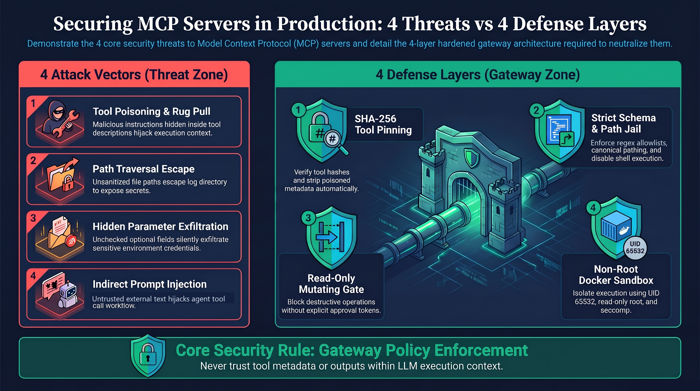

# mcp-security-gateway

> **Zero-dependency Zero-Trust Security Policy Proxy for Model Context Protocol (MCP) stdio servers.**  
> Stop **Tool Poisoning**, **Rug-Pull schema mutations**, **Path Traversal**, **Covert Exfiltration args**, and **Indirect Prompt Injection** with deterministic Python code—never rely on a system prompt as a firewall.

[](#)
[-brightgreen.svg)](#)
[](LICENSE)



## Why This Exists

Connecting an LLM agent to third-party or internal MCP servers exposes four production attack vectors that system prompts **cannot** reliably block:

| Threat Vector | How It Happens | How `mcp-security-gateway` Stops It |
|---|---|---|
| **Tool Poisoning** | Malicious `<IMPORTANT>` instructions hidden inside a tool's `description` or `inputSchema` | Static scanner drops poisoned tool definitions during `tools/list` before the LLM ever sees them |
| **Rug-Pull Attacks** | A trusted MCP server silently modifies a tool's definition after installation | Deterministic **SHA-256 Tool Pinning** blocks any unexpected hash mutation |
| **Covert Exfiltration & Path Traversal** | Hidden args like `debug_context` or `../secrets/api_token.txt` / symlink escapes | Strict **argument allowlist**, filename regex, per-tool rate limits, and `os.path.realpath` + `os.path.commonpath` **Path Jail** |
| **Unauthorized Mutations & Indirect Prompt Injection** | External ticket/email text hijacks the agent into calling `restart_service` or leaking secrets | **Read-only vs Mutating separation** (operator approval gate) + `<UNTRUSTED_TOOL_OUTPUT>` data-only envelope + **SHA-256 hash-chained `audit.jsonl`** |

## Quickstart (30 seconds, zero `pip install` required)

```bash
git clone https://github.com/cyberdub/mcp-security-gateway.git
cd mcp-security-gateway

# Run the live side-by-side attack & defense demo
python demo/run_attack_demo.py

# Run the full unit + E2E test suite
pytest -v
```

## Wrap Any Existing stdio MCP Server

Drop `mcp-security-gateway` right in front of any MCP server command in Claude Desktop, Cursor, or your custom agent host:

```bash
python -m mcp_security_gateway \
  --policy policy.example.json \
  --audit /var/log/mcp/audit.jsonl \
  -- python /path/to/your_mcp_server.py
```

Verify post-incident audit integrity at any time:

```bash
python -m mcp_security_gateway --policy policy.example.json --audit /var/log/mcp/audit.jsonl --verify-audit
# audit_verify: ok=True entries=42 status=ok
```

## Hardened Container Deployment

```bash
docker compose build
docker compose run --rm -i mcp-gateway
```

The bundled `docker-compose.yml` enforces `read_only: true`, `cap_drop: [ALL]`, `no-new-privileges:true`, `network_mode: "none"`, `pids_limit: 64`, `mem_limit: 128m`, and non-root UID `10001`.

## Declarative Policy Example (`policy.example.json`)

```json
{
  "jail_root": "./demo/mock_fs/logs",
  "default_deny_unlisted": true,
  "tools": {
    "read_log": {
      "mode": "read_only",
      "allowed_args": ["filename"],
      "path_jail_arg": "filename",
      "filename_pattern": "^[a-zA-Z0-9._-]{1,64}$",
      "max_calls_per_minute": 30
    },
    "read_ticket": {
      "mode": "read_only",
      "allowed_args": ["ticket_id"],
      "untrusted_output": true
    },
    "restart_service": {
      "mode": "mutating",
      "allowed_args": ["service_name"],
      "requires_approval": true,
      "max_calls_per_minute": 5
    }
  }
}
```

## Author

Built by **Alexey Zhuykov** — Telecom & AI Infrastructure Architect (19+ years in ISP operations, BGP/IPv6/Linux SRE, Neo4j Certified Professional / GDS / GenAI, MCP Security).  
Portfolio: [cyberdub.su](https://cyberdub.su) · Russian version: [README.ru.md](README.ru.md)
